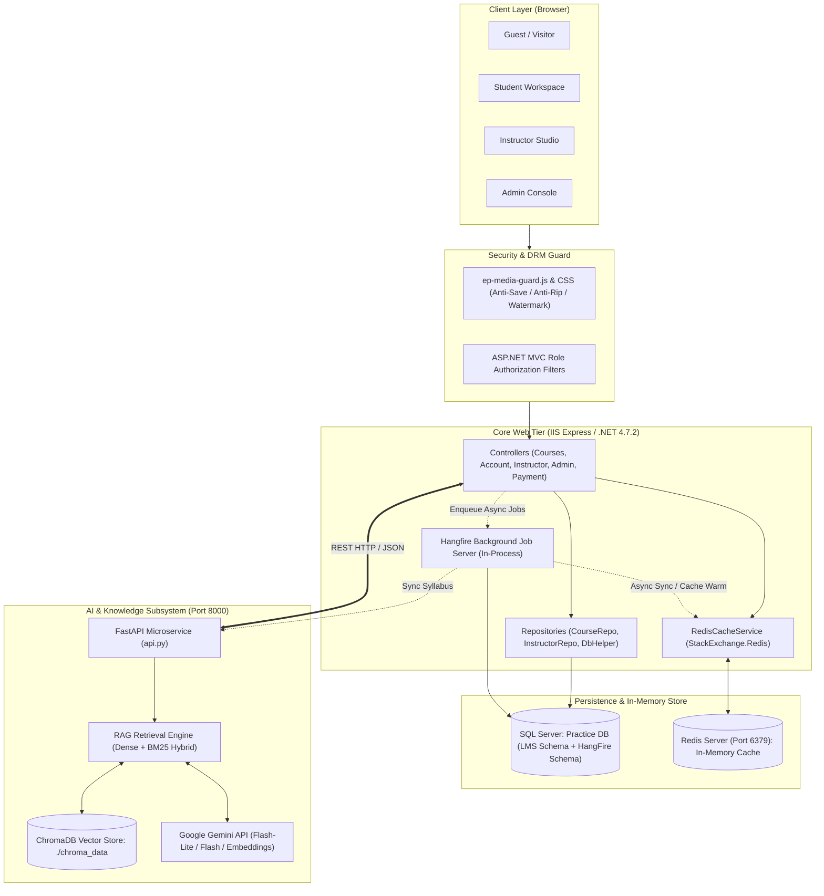
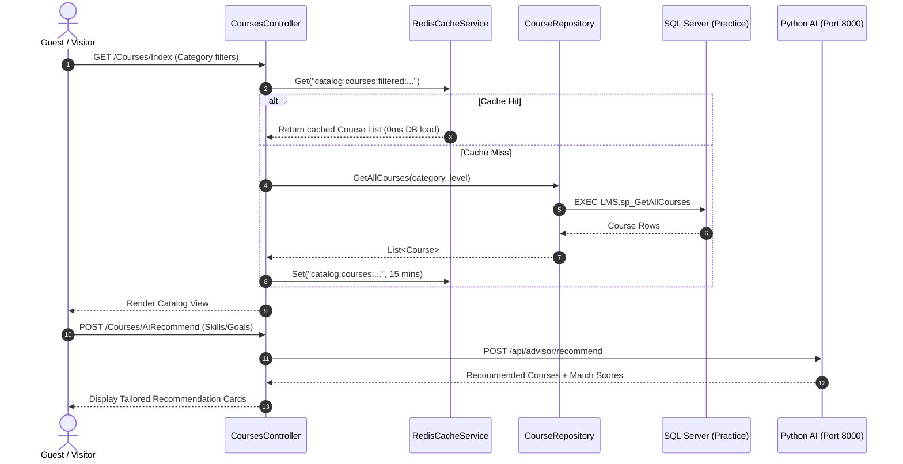
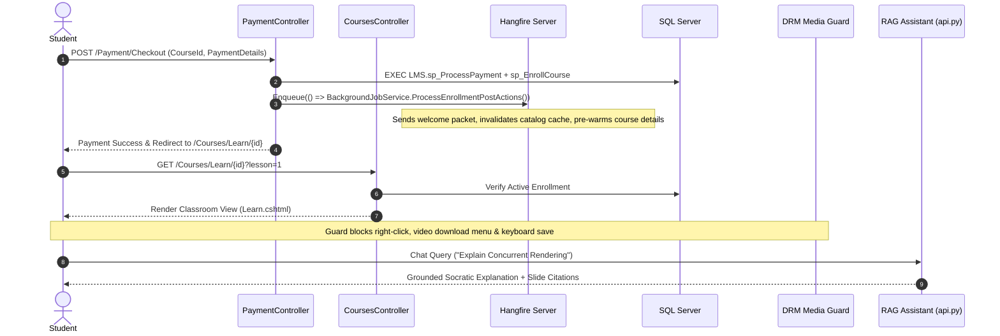
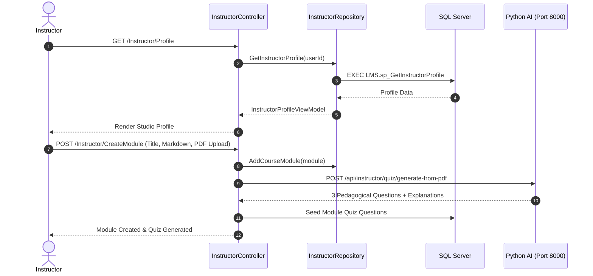
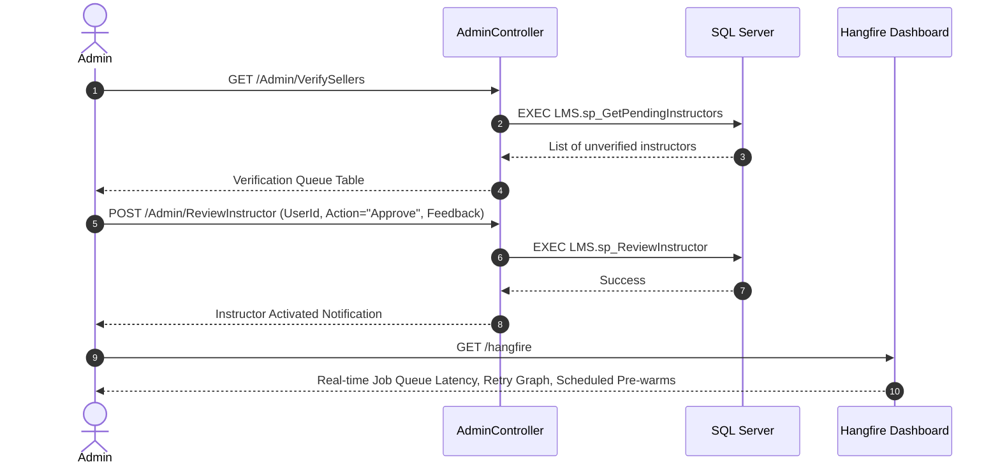

# EduPulse LMS: Architecture, Workflows & File Catalog

> **Target Platform:** EduPulse Enterprise Learning Management System  
> **Architecture Style:** Monolithic Web Core (ASP.NET MVC 5) + Microservice AI Subsystem (FastAPI) + Asynchronous Job Engine (Hangfire) + Distributed Cache (Redis)

---

## 1. High-Level Architecture Overview

EduPulse is engineered as a high-concurrency learning platform that separates synchronous user-facing web operations from heavy computational workloads (RAG embeddings, LLM generation, catalog pre-warming, and enrollment post-processing).

---

## 2. Role-Based Workflows & Code Execution Paths

EduPulse provides strict role-based separation across 4 distinct user profiles: **Guest/Visitor**, **Student**, **Instructor**, and **System Admin**.

### 2.1. Guest / Visitor Workflow
* **Capabilities:** Explore course catalog, filter categories, view pricing, test AI course recommendations, view public syllabus, register/login.
* **Security Restriction:** Cannot access classroom player, cannot take quizzes, cannot download materials, cannot access instructor/admin consoles.

---

### 2.2. Student Workflow
* **Capabilities:** Enroll in free/paid courses, checkout via simulated gateway, view interactive lessons, read lecture PDFs via secure canvas reader, take end-of-lesson quizzes, submit assignments, query Socratic AI assistant, download completion certificates.
* **Security & DRM:** Content download protection active (no right-click, no `Ctrl+S`, `controlsList="nodownload"` on video, dynamic forensic student watermark).

---

### 2.3. Instructor Workflow
* **Capabilities:** Complete professional KYC profile, create new courses, manage modular syllabus, upload lecture slides (PDF/Video), generate multiple-choice quizzes with Gemini AI, review student assignment submissions, grade homework with rubric scores and feedback.
* **Verification Gate:** Newly registered instructors require System Admin verification (`IsApproved == 1`) before courses can be published.

---

### 2.4. System Admin Workflow
* **Capabilities:** View platform analytics, approve/reject pending instructor applications, inspect instructor KYC credentials (degree, portfolio, ID, digital signature), audit payments and revenue, inspect Redis health and Hangfire job dashboard.

---

## 3. Comprehensive File Catalog & Location Map

### 3.1. ASP.NET MVC Core Tier (`WebApplication1/`)

| File Path | Layer | Responsibility / Usage |
| :--- | :--- | :--- |
| `Controllers/CoursesController.cs` | Controller | Catalog filtering, course details, classroom player (`Learn`), benchmark endpoint (`/Courses/Benchmark`), and AI recommender proxy. |
| `Controllers/InstructorController.cs`| Controller | Instructor studio: profile onboarding, course drafting, curriculum module editor, AI quiz generator bridge, and student assignment grading. |
| `Controllers/AdminController.cs` | Controller | Platform governance: instructor KYC verification, course publication audit, revenue analytics. |
| `Controllers/AccountController.cs` | Controller | Authentication, registration, session management, and role-based redirect routing. |
| `Controllers/PaymentController.cs` | Controller | Checkout simulation, invoice generation, tax invoice PDF rendering, and enrollment processing. |
| `Controllers/ChatbotController.cs` | Controller | Reverse-proxy gateway routing student and instructor floating widget messages to FastAPI (Port 8000). |
| `Services/RedisCacheService.cs` | Infrastructure | High-performance wrapper over `StackExchange.Redis` for catalog caching, course details caching, pattern eviction, and health diagnostics. |
| `Services/BackgroundJobService.cs` | Infrastructure | Hangfire task runner: catalog cache pre-warming, post-enrollment email dispatch, and asynchronous course-to-AI sync. |
| `Services/CloudinaryService.cs` | Infrastructure | Multipart media uploader for instructor profile photos and digital signatures with graceful local disk fallback. |
| `Repositories/CourseRepository.cs` | Data Access | ADO.NET data access executing stored procedures for courses, categories, enrollments, reviews, and progress tracking. |
| `Repositories/InstructorRepository.cs`| Data Access | Stored procedure client for instructor profiles, curriculum modules, student assignment submissions, and quiz attempts. |
| `Data/DbHelper.cs` | Data Access | Centralized ADO.NET helper executing parameterized SQL queries, commands, DataTables, and transactions. |
| `Data/DatabaseInitializer.cs` | Data Access | Startup database migration hook creating core LMS tables and default demo users if they do not exist. |
| `Startup.cs` | OWIN Startup | Registers Hangfire server, mounts `/hangfire` real-time management dashboard, and triggers standing recurring jobs. |
| `Web.config` | Configuration | Connection strings (`LmsConnection`), Cloudinary keys, assembly binding redirects, and HTTP static file handlers. |

---

### 3.2. Learning Views & Client Security Assets (`Views/` & `Scripts/`)

| File Path | Layer | Responsibility / Usage |
| :--- | :--- | :--- |
| `Views/Courses/Learn.cshtml` | View (Razor) | Classroom player view: PDF.js canvas viewer, direct HTML5 video stream, dynamic student watermark, and end-of-lesson quiz drawer. |
| `Views/Courses/Details.cshtml` | View (Razor) | Comprehensive course details page with curriculum syllabus accordion, protected cheatsheets list, and AI drawer prompt launchers. |
| `Views/Instructor/Modules.cshtml` | View (Razor) | Curriculum editor with module drag-order, PDF upload, study guide manager, and AI quiz trigger. |
| `Views/Instructor/ManageQuiz.cshtml` | View (Razor) | Instructor quiz manager allowing manual question authoring and one-click AI quiz generation from slide notes. |
| `Views/Instructor/Submissions.cshtml`| View (Razor) | Student assignment grading desk with modal document viewer, rubric sliders, and feedback form. |
| `Views/Shared/_Layout.cshtml` | Shared View | Master layout hosting role-specific navbars, global alerts, media guard scripts, and floating AI chat widget. |
| `Views/Shared/_ChatWidget.cshtml` | Shared View | Floating Socratic AI Teaching Assistant UI with markdown rendering, LaTeX math (KaTeX), citation pills, and prompt suggestion chips. |
| `Content/ep-media-guard.css` | Stylesheet | Digital rights protection CSS: disables text/media selection, styles forensic watermarks, and blanks view during print (`Ctrl+P`). |
| `Scripts/ep-media-guard.js` | Client Script | Digital rights protection JS: intercepts right-click on media, blocks `Ctrl+S`/`Ctrl+P`, disables image drag, overrides canvas export. |
| `Uploads/web.config` | IIS Config | Sets response headers on static files (`Content-Disposition: inline`, `X-Download-Options: noopen`, `Cache-Control: no-store`). |

---

### 3.3. Python RAG Assistant Microservice (`WebApplication1/Rag_Service/`)

| File Path | Role | Responsibility / Usage |
| :--- | :--- | :--- |
| `api.py` | FastAPI Core | REST microservice exposing `/api/chat`, `/api/instructor/quiz/generate-from-pdf`, `/api/advisor/recommend`, and health endpoints. |
| `rag_engine.py` | RAG Pipeline | Context assembler: query classification, RBAC filtering, citation generation, and system prompt orchestration. |
| `hybrid_search.py` | Search Engine | Reciprocal Rank Fusion (RRF) combiner uniting dense semantic vector search with sparse BM25 keyword matching. |
| `vector_store.py` | Vector Storage | ChromaDB persistent store management, chunk insertion, and Google Gemini embedding calculation (`gemini-embedding-001`). |
| `instructor_tools.py` | Instructor AI | Tools for automated quiz authoring from PDF slides, student assignment rubric evaluation, and course consistency auditing. |
| `course_recommender.py` | Recommendation | Semantic vector recommender matching student career goals to course curriculum modules using cosine similarity. |
| `security_guardrails.py` | Guardrails | Prompt injection detection, jailbreak suppression, toxic input filtering, and role-boundary validation. |
| `resilience.py` | Reliability | Sliding-window rate limiter (bot defense), semantic response cache (5ms repeated query returns), and tiered model cascading. |
| `ingest_study_materials.py` | Ingestion Script | Standalone pipeline indexing lecture slide PDFs into ChromaDB with course and module metadata tags. |
| `.env` | Configuration | Environment variables: `GEMINI_API_KEY`, `CHAT_MODEL`, `EMBEDDING_MODEL`, and `CHROMA_DB_DIR`. |
