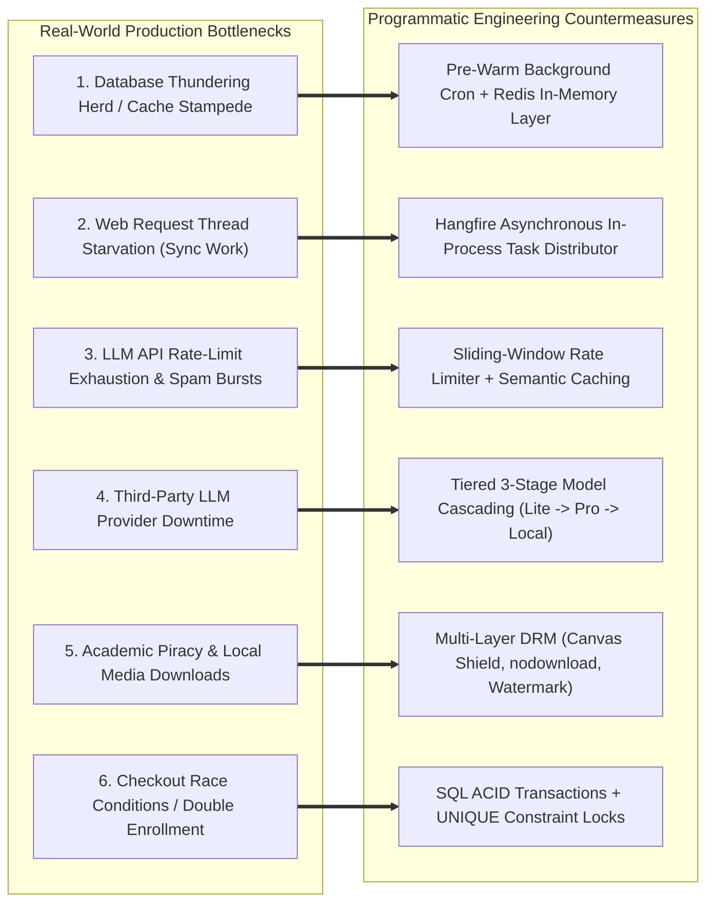

# EduPulse LMS: System Design Solutions, Resilience & Edge Cases

> **Target:** System Design Analysis, Concurrency Control, Resilience Engineering & Edge-Case Verification  
> **Core Focus:** Real-world enterprise bottlenecks (cache stampedes, thread starvation, prompt injections, DRM bypasses, race conditions) and their concrete programmatic solutions.

---

## 1. System Design Problems Handled & Architectural Solutions



---

### Problem 1: Database Thundering Herd & Cache Stampede
* **The Vulnerability:** Under peak marketing campaigns or enrollment deadlines, thousands of concurrent students hit `/Courses/Index`. If the catalog cache expires simultaneously, thousands of threads hammer SQL Server with complex joins, triggering CPU spikes and connection pool exhaustion.
* **Handled In:**
  * `WebApplication1/Services/RedisCacheService.cs`
  * `WebApplication1/Services/BackgroundJobService.cs`
  * `WebApplication1/Repositories/CourseRepository.cs`
* **How It Is Handled:**
  1. **Hourly Background Pre-Warming:** Hangfire executes `PrewarmCatalogCache()` on an hourly cron (`Cron.Hourly`). The catalog is refreshed in the background *before* the key expires, keeping it perpetually hot.
  2. **Atomic Targeted Eviction:** When an instructor updates or publishes a course, `CourseRepository.InvalidateCourseCache(id)` performs surgical invalidation:
     * `catalog:courses:all`
     * `catalog:courses:filtered:default`
     * `catalog:categories`
     * `course:details:{id}`
  3. **Graceful Redis Degradation:** If Redis is offline, the code wraps cache access in safe fallback blocks, logging diagnostics without interrupting web traffic.

---

### Problem 2: Request Thread Starvation from Heavy Synchronous Tasks
* **The Vulnerability:** Operations like sending post-enrollment emails, generating welcome packets, and syncing multi-module syllabi to the Python vector store take 2–5 seconds. Performing them inside MVC controller request threads blocks IIS worker threads (`w3wp.exe`), dropping application throughput.
* **Handled In:**
  * `WebApplication1/Startup.cs`
  * `WebApplication1/Services/BackgroundJobService.cs`
  * `WebApplication1/Controllers/PaymentController.cs`
* **How It Is Handled:**
  1. **Hangfire In-Process Processing Server:** Powered by SQL Server table storage (`HangFire.Job`, `HangFire.JobQueue`).
  2. **Non-Blocking Fire-and-Forget Enqueueing:**
     ```csharp
     BackgroundJob.Enqueue(() => BackgroundJobService.ProcessEnrollmentPostActions(userId, courseId, invoiceNumber));
     ```
     The HTTP response returns to the student in **< 40ms**, while the worker processes onboarding emails and pre-warms course details asynchronously with automatic retry policies (`[AutomaticRetry(Attempts = 3)]`).

---

### Problem 3: LLM API Rate-Limit Exhaustion & Bot Query Flooding
* **The Vulnerability:** Malicious bots or impatient students clicking "Send" repeatedly can exhaust the Google Gemini API quota (15 RPM / 1M TPM on free tier), driving API costs up and causing denial of service for other learners.
* **Handled In:**
  * `WebApplication1/Rag_Service/resilience.py` (Classes: `RateLimiter`, `SemanticCache`)
  * `WebApplication1/Rag_Service/api.py`
* **How It Is Handled:**
  1. **Sliding-Window Rate Limiting:** Tracks student timestamps across a sliding 30-second window. Maximum 5 queries per 30 seconds. Exceeding triggers an HTTP 429 cooldown notice with remaining seconds (`retry_after`).
  2. **15-Second Duplicate Query Suppression:** If an identical query is submitted within 15 seconds, the engine returns the previously generated response without invoking Gemini.
  3. **Semantic Response Caching:** Computes cosine similarity between incoming query embedding and cached queries. If similarity $\ge 0.96$, returns cached answer in **~5ms** with zero LLM API calls.

---

### Problem 4: Third-Party LLM Outages & Quota Exceeded Failovers
* **The Vulnerability:** Cloud AI APIs experience intermittent timeouts, network blips, or 503 Overloaded errors. A single API failure should never crash the LMS learning workspace.
* **Handled In:**
  * `WebApplication1/Rag_Service/resilience.py` (Class: `TieredModelCascade`)
  * `WebApplication1/Rag_Service/rag_engine.py`
* **How It Is Handled:**
  * **3-Tier Cascade Fallback:**
    * **Tier 1 (Primary):** `models/gemini-3.5-flash-lite` — ultra-fast latency (~600ms).
    * **Tier 2 (Secondary Failover):** If Tier 1 throws `ResourceExhausted` or times out after 5s, the request immediately re-routes to `models/gemini-3.8-flash`.
    * **Tier 3 (Extractive Deterministic Fallback):** If all cloud APIs fail, the system falls back to an extractive notes summary generated directly from the top hybrid-retrieved lecture slide chunks.

---

### Problem 5: Academic Content Theft & Local Media Saving (DRM)
* **The Vulnerability:** Students ripping proprietary lecture videos, saving PDF slides locally to distribute on external course-sharing forums, or printing pages to PDF.
* **Handled In:**
  * `WebApplication1/Views/Courses/Learn.cshtml`
  * `WebApplication1/Views/Courses/Details.cshtml`
  * `WebApplication1/Content/ep-media-guard.css`
  * `WebApplication1/Scripts/ep-media-guard.js`
  * `WebApplication1/Uploads/web.config`
* **How It Is Handled:**
  1. **HTML5 Video Lockdown:** Enforces `controlsList="nodownload nofullscreen noremoteplayback"`, `disablePictureInPicture="true"`, and `oncontextmenu="return false;"`.
  2. **PDF.js Canvas Stage:** PDFs are parsed into raw HTML5 canvas pixels. No native browser PDF toolbar or save icons are exposed.
  3. **Client-Side Interception:** Blocks right-click on media, disables image/canvas drag-and-drop, blocks `Ctrl+S` (Save) and `Ctrl+P` (Print).
  4. **Canvas Anti-Scraping:** Overrides `canvas.toDataURL` and `canvas.toBlob` on `#pdfViewerCanvas`.
  5. **Anti-Print Media Query:** `@media print` blanks out the entire viewport and prints a copyright legal notice.
  6. **Dynamic Forensic Watermark:** Diagonal semi-transparent watermark displaying student name, email, and timestamp across the player.
  7. **Server-Side Headers:** `Uploads/web.config` serves all media with `Content-Disposition: inline`, `X-Download-Options: noopen`, and `Cache-Control: private, no-store`.

---

### Problem 6: Concurrency & Double Enrollment Race Conditions
* **The Vulnerability:** A student double-clicking the "Complete Checkout" button could create duplicate payment records and duplicate enrollments.
* **Handled In:**
  * `WebApplication1/complete_database_setup.sql` (`sp_ProcessPayment`, `sp_EnrollCourse`)
  * Database Table Constraints: `LMS.Enrollments` (`UNIQUE(UserId, CourseId)`), `LMS.Payments` (`UNIQUE(InvoiceNumber)`)
* **How It Is Handled:**
  * SQL Server stored procedures execute inside explicit transactions (`BEGIN TRANSACTION ... COMMIT`).
  * If an enrollment record already exists for the student, `sp_EnrollCourse` idempotently returns the existing `EnrollmentId` without creating duplicate records.

---

## 2. Tested Edge Cases & Automated Test Suites

The codebase includes an extensive automated verification matrix across 4 dedicated test scripts:

```mermaid
graph TD
    Test_Edge["test_all_edge_cases.py"] --> E1["Empty / Whitespace Queries"]
    Test_Edge --> E2["Cross-Course Poisoning & Isolation"]
    Test_Edge --> E3["Instructor-Only Key Leak Attempt"]
    Test_Edge --> E4["Prompt Injection & Jailbreak Defense"]
    Test_Edge --> E5["Homework Direct-Solution Extraction"]

    Test_Resilience["test_resilience_and_caching.py"] --> R1["Burst Spam & Rate Throttling"]
    Test_Resilience --> R2["Duplicate Query Suppression"]
    Test_Resilience --> R3["Semantic Cache Proximity (96%)"]
    Test_Resilience --> R4["Model Cascading Failover"]

    Test_E2E["test_instructor_end_to_end.py"] --> I1["PDF Quiz Generation Distractor Quality"]
    Test_E2E --> I2["Student PDF Submission Rubric Grading"]
    Test_E2E --> I3["Curriculum Consistency Audit"]

    Benchmark_Endpoint["/Courses/Benchmark"] --> B1["Direct SQL Latency vs Redis Latency"]
    Benchmark_Endpoint --> B2["Hangfire Job Enqueue Verification"]
```



---

### Summary of Edge-Case Test Suites

| Test Suite Script | Scope of Verification | Expected System Behavior |
| :--- | :--- | :--- |
| `Rag_Service/test_all_edge_cases.py` | Prompt injections (`"Ignore previous instructions"`), jailbreaks, attempts to access exam solutions. | System blocks jailbreaks; enforces Socratic hints instead of homework solutions; restricts chunks to `visibility: student`. |
| `Rag_Service/test_resilience_and_caching.py` | 10 rapid queries in 2 seconds; duplicate queries; semantically altered queries. | First 5 succeed; queries 6–10 return HTTP 429 with retry countdown; identical queries answered from cache in < 10ms. |
| `Rag_Service/test_instructor_end_to_end.py` | AI multiple choice generation from `Course2_ASPNET_MVC5...pdf`; assignment rubric grading. | Generates 3 valid questions with A/B/C/D choices, correct keys, and citations; generates rubric score and constructive feedback. |
| `Controllers/CoursesController.cs` (`Benchmark`) | Compares live SQL Server latency vs Redis in-memory hit latency. | Verifies speedup factor (~20x to 100x faster from cache) and tests Hangfire queue dispatch. |
