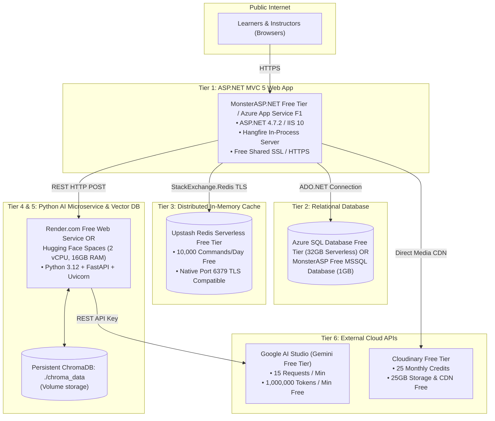

# EduPulse LMS: 100% Zero-Cost Free-Tier Production Deployment Guide

> **Deployment Objective:** Host all 6 tiers of the EduPulse LMS (Web, Database, Cache, Background Jobs, AI Microservice, Vector DB, Media Storage) in production **without spending a single dollar** and without required credit cards.

---

## 1. Zero-Cost Free-Tier Architecture Blueprint



---

## 2. Service-by-Service Free Tier Breakdown

| Component | Recommended Free Provider | Free Tier Allocation | Credit Card Required? |
| :--- | :--- | :--- | :--- |
| **Web Application (MVC 5)** | [MonsterASP.NET](https://www.monsterasp.net/) / Azure App Service F1 | Full ASP.NET .NET Framework 4.7.2 support, IIS, free SSL | **No** (MonsterASP) |
| **Database (SQL Server)** | Azure SQL Database Serverless Free Tier / MonsterASP MSSQL | 32 GB storage, 100,000 vCore seconds/month free | **No** (MonsterASP) |
| **Redis Cache** | [Upstash Redis](https://upstash.com/) Serverless | 10,000 free commands per day, low latency | **No** |
| **Python RAG Microservice** | [Render.com](https://render.com/) Free Web Service or [Hugging Face Spaces](https://huggingface.co/spaces) | 750 free hours/mo (Render) or 2 vCPUs, 16GB RAM (HF Spaces) | **No** |
| **Vector Database** | ChromaDB (Local persistent file on container disk) | Included in Render / HF Spaces container disk | **No** |
| **LLM & Embeddings** | [Google AI Studio](https://aistudio.google.com/) | 15 RPM, 1M TPM, 1,500 daily requests free | **No** |
| **Media Cloud Storage** | [Cloudinary](https://cloudinary.com/) | 25 Credits/mo (25GB storage, 25K transformations) | **No** |

---

## 3. Step-by-Step Deployment Instructions

### Tier 1: Deploying the ASP.NET MVC Application on MonsterASP.NET (Free)

1. **Sign Up:** Create a free account at [MonsterASP.NET](https://www.monsterasp.net/) (Instant activation, no credit card required).
2. **Create Website:** Select **"Create Free Website"** and choose .NET Framework **v4.8 / v4.7.2**.
3. **Publishing from Visual Studio / Local Machine:**
   * In Visual Studio, right-click `WebApplication1` -> **Publish**.
   * Select **Folder** profile -> target location: `f:\MCC_Practice\Projects\LMS\publish`.
   * Click **Publish**.
   * In MonsterASP.NET Control Panel, use **Web FTP** or **FTP Credentials** (FileZilla) to upload all contents of the `publish/` folder into `wwwroot/`.
4. **Configure HTTPS:** Click **"Free Let's Encrypt SSL"** in the MonsterASP control panel to enable `https://your-site.monsterasp.net/`.

---

### Tier 2: Deploying SQL Server Database

#### Option A: MonsterASP.NET Free MSSQL (Easiest)
1. In MonsterASP control panel, go to **Databases** -> **Create MSSQL Database** (Free 1GB tier).
2. Copy the Connection String:
   ```text
   Data Source=mssqlXXXX.monsterasp.net;Initial Catalog=your_db;User Id=your_user;Password=your_pass;TrustServerCertificate=True;
   ```
3. Open **SQL Server Management Studio (SSMS)** or `sqlcmd` on your computer, connect to `mssqlXXXX.monsterasp.net`, and execute:
   * `WebApplication1/complete_database_setup.sql`
4. Update `LmsConnection` in `Web.config`:
   ```xml
   <connectionStrings>
     <add name="LmsConnection" 
          connectionString="Data Source=mssqlXXXX.monsterasp.net;Initial Catalog=your_db;User Id=your_user;Password=your_pass;TrustServerCertificate=True;" 
          providerName="System.Data.SqlClient" />
   </connectionStrings>
   ```

---

### Tier 3: Setting Up Free Serverless Redis (Upstash)

1. Navigate to [Upstash.com](https://upstash.com/) and sign in with GitHub or Google.
2. Click **Create Database** -> Name: `edupulse-cache` -> Type: **Serverless Redis**.
3. Select the closest region (e.g., `AWS ap-south-1 Mumbai` or `AWS us-east-1`).
4. Select **Free Plan** (10,000 commands/day, zero cost).
5. Copy the **Primary Endpoint** and **Password**:
   ```text
   Endpoint: optimal-example-12345.upstash.io:6379
   Password: your_upstash_token
   ```
6. In `WebApplication1/Services/RedisCacheService.cs`, update the Redis connection string:
   ```csharp
   private static readonly Lazy<ConnectionMultiplexer> LazyConnection = new Lazy<ConnectionMultiplexer>(() =>
   {
       var options = ConfigurationOptions.Parse("optimal-example-12345.upstash.io:6379,password=your_upstash_token,ssl=true,abortConnect=false,connectTimeout=5000");
       return ConnectionMultiplexer.Connect(options);
   });
   ```

---

### Tier 4 & 5: Deploying Python RAG Microservice on Render (Free)

1. **Prepare Git Repository:**
   Push your `WebApplication1/Rag_Service/` code to a GitHub repository.
2. **Create Web Service on Render:**
   * Go to [Render.com](https://render.com/) -> **New +** -> **Web Service**.
   * Connect your GitHub repository.
   * **Root Directory:** `WebApplication1/Rag_Service`
   * **Runtime:** `Python 3`
   * **Build Command:**
     ```bash
     pip install -r requirements.txt
     ```
   * **Start Command:**
     ```bash
     uvicorn api:app --host 0.0.0.0 --port 10000
     ```
   * **Instance Type:** Select **Free** (512MB RAM, 750 free hours).
3. **Set Environment Variables on Render:**
   In the Render dashboard, click **Environment** -> **Add Environment Variable**:
   * `GEMINI_API_KEY`: `your_gemini_api_key_here`
   * `CHAT_MODEL`: `models/gemini-3.5-flash-lite`
   * `EMBEDDING_MODEL`: `models/gemini-embedding-001`
   * `CHROMA_DB_DIR`: `./chroma_data`
4. **Deploy & Copy Public URL:**
   Render provides a free URL: `https://edupulse-ai.onrender.com`.
5. **Connect ASP.NET MVC to Render AI Service:**
   In `WebApplication1/Web.config`, set your AI microservice URL:
   ```xml
   <appSettings>
     <add key="AiMicroserviceUrl" value="https://edupulse-ai.onrender.com" />
   </appSettings>
   ```

---

### Tier 6: Configuring Media Storage (Cloudinary Free Plan)

1. Log into your [Cloudinary Console](https://cloudinary.com/).
2. Grab your existing keys:
   * **Cloud Name:** (from Cloudinary dashboard)
   * **API Key:** `your_cloudinary_api_key`
   * **API Secret:** `your_cloudinary_api_secret`
3. Update `WebApplication1/Web.config`:
   ```xml
   <appSettings>
     <add key="Cloudinary:CloudName" value="your_cloud_name" />
     <add key="Cloudinary:ApiKey" value="your_cloudinary_api_key" />
     <add key="Cloudinary:ApiSecret" value="your_cloudinary_api_secret" />
   </appSettings>
   ```

---

## 4. Free Tier Maintenance & Sleep Prevention

* **Render Free Tier Spin-Down:**
  Render's free tier spins down after 15 minutes of inactivity. To keep the AI assistant instantaneously responsive, set up a free 5-minute health ping using [UptimeRobot](https://uptimerobot.com/) (Free 50 monitors) targeting:
  `https://edupulse-ai.onrender.com/` (HTTP GET returns `{"status": "online"}`).
* **Upstash Redis Command Quota:**
  10,000 commands/day translates to ~7 commands/minute. The hourly Hangfire cache pre-warmer and 15-minute TTL catalog cache easily fit within 5% of this free quota.
