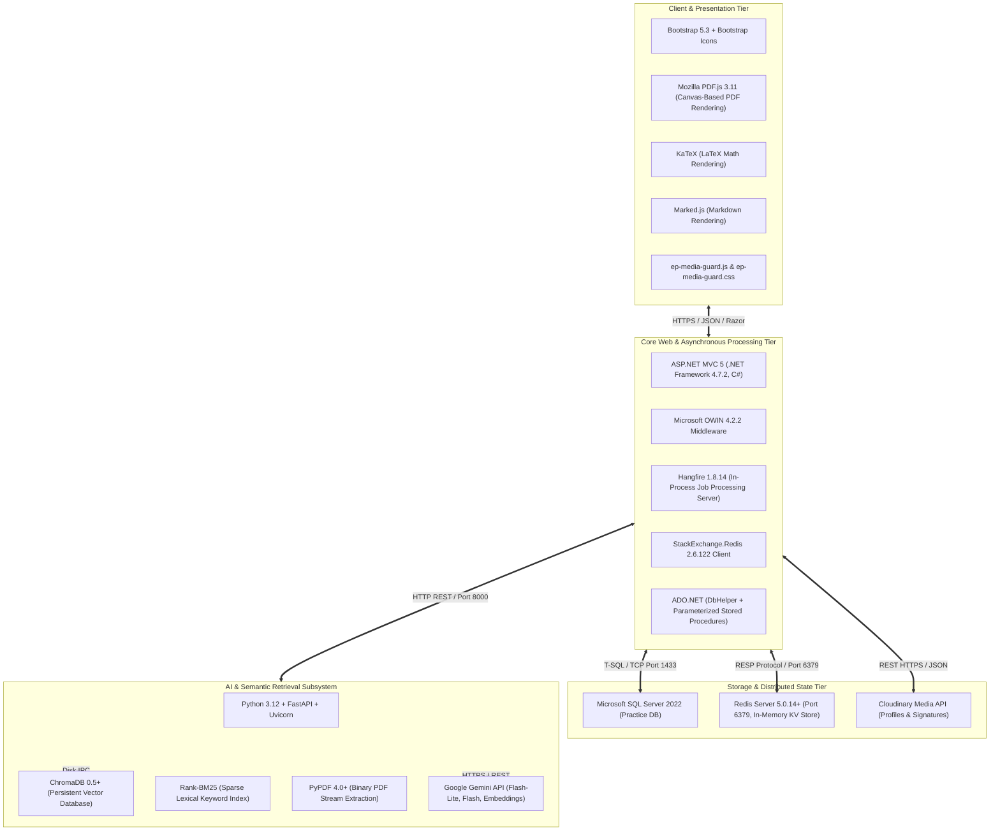
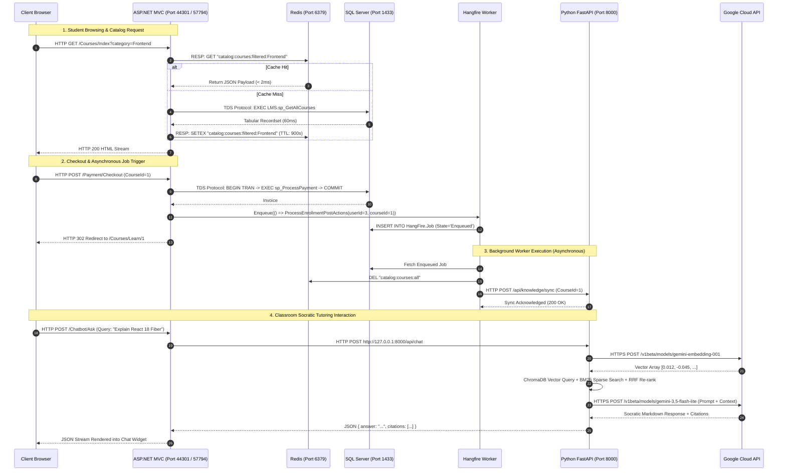

# EduPulse LMS: Tech Stack Justifications & Inter-Service Communication Protocol

> **System Target:** Comprehensive Technology Stack Rationale, Service Responsibilities & Cross-Tier Communication Protocols.

---

## 1. Complete Technology Stack Matrix

---

## 2. Technology Selection Rationale ("Why This Stack?")

### 2.1. ASP.NET MVC 5 (.NET Framework 4.7.2 & C#)
* **Role:** Serves user sessions, authentication, server-rendered Razor views, and enterprise business logic.
* **Why Selected:**
  * **Strict Typing & Enterprise Stability:** C# provides compile-time safety, robust LINQ data modeling, and high performance.
  * **Rock-Solid Security Pipeline:** Built-in protection against Cross-Site Request Forgery (`[ValidateAntiForgeryToken]`), Cross-Site Scripting (HTML-encoded Razor syntax), and SQL Injection (ADO.NET parameter binding).
  * **OWIN Extensibility:** Easily embeds middleware components like Hangfire dashboards without needing an external web server process.

### 2.2. Microsoft SQL Server 2022 (T-SQL & Stored Procedures)
* **Role:** Single source of truth for platform users, course catalogs, enrollment progress, payment invoices, and student quiz attempts.
* **Why Selected:**
  * **ACID Guarantees:** Ensures zero double-enrollment or lost payments under high checkout concurrency through transactional locks (`BEGIN TRANSACTION`).
  * **Stored Procedure Isolation:** Keeping queries in stored procedures (`LMS.sp_*`) prevents dynamic SQL injection vulnerabilities, optimizes query execution plans in SQL cache, and allows schema modifications without recompiling the web application.

### 2.3. Redis Server (StackExchange.Redis)
* **Role:** High-speed in-memory caching for course catalog queries, category lists, course detail payloads, and rate limits.
* **Why Selected:**
  * **Sub-Millisecond Read Latency:** Bypasses SQL Server for 95% of catalog browse requests, serving course lists in **< 2ms**.
  * **Memory-Efficient Key-Value Serialization:** JSON-serialized data structures with customizable Time-To-Live (TTL) policies and pattern-based cache eviction (`catalog:courses:*`).

### 2.4. Hangfire 1.8.14 (Background Processing Server)
* **Role:** In-process asynchronous task distributor and recurring cron scheduler.
* **Why Selected:**
  * **No Separate Windows Service Required:** Runs directly inside the IIS application pool (`Clr4IntegratedAppPool`).
  * **Persistent SQL Storage:** Job state is saved in `HangFire.*` SQL tables. If IIS restarts, in-flight jobs are never lost and automatically resume.
  * **Built-In Live Dashboard:** Visual inspection of job queues, retry attempts, and latency metrics directly at `/hangfire`.

### 2.5. Python 3.12 + FastAPI + ChromaDB (Port 8000)
* **Role:** Autonomous AI microservice executing document parsing, vector retrieval, and LLM orchestration.
* **Why Selected:**
  * **Rich AI Ecosystem:** Python provides native bindings for scientific libraries (`numpy`, `pypdf`, `rank_bm25`, `chromadb`, `google-generativeai`).
  * **Asynchronous High Concurrency (FastAPI):** Built on Starlette and Pydantic, FastAPI handles concurrent student chat streams with non-blocking async event loops.
  * **Serverless Local Vector DB (ChromaDB):** Persistent vector embeddings saved directly to disk (`./chroma_data`), eliminating the need for expensive third-party managed vector cloud providers.

### 2.6. Google Gemini Models (Flash-Lite & Flash)
* **Role:** Embeddings computation, Socratic tutoring, and quiz generation.
* **Why Selected:**
  * **Cost-Efficiency & Latency:** `gemini-3.5-flash-lite` provides sub-second conversational latency and costs a fraction of GPT-4o, making high-volume student Q&A financially sustainable.
  * **Generous Free Tier:** Google AI Studio allows 15 RPM / 1M TPM free, enabling full testing without infrastructure expenditure.

---

## 3. Inter-Service Communication Protocols

EduPulse employs standardized protocols between each tier to ensure fault isolation and prevent cascading failures:

---

## 4. Communication Channel Security & Error Fallback Matrix

| Channel | Protocol | Payload Type | Fallback Policy on Connection Outage |
| :--- | :--- | :--- | :--- |
| **Browser $\rightarrow$ MVC** | HTTPS / TLS 1.2+ | HTML / Form Data / JSON | Browser displays standard user-friendly error page; static assets served from cache. |
| **MVC $\rightarrow$ SQL Server** | TDS (TCP 1433) | Parameterized ADO.NET | Connection retry logic; database failure logs to Windows Event Viewer and `Debug.WriteLine`. |
| **MVC $\rightarrow$ Redis** | RESP (TCP 6379) | Serialized JSON Strings | `RedisCacheService.IsConnected` switches to `false`; application falls back directly to SQL Server seamlessly. |
| **MVC $\rightarrow$ Python AI** | HTTP REST (TCP 8000) | JSON (`ChatRequestDto`) | Returns polite fallback message: *"The AI Assistant is currently undergoing scheduled indexing. Please consult lecture slides directly."* |
| **Python $\rightarrow$ Gemini API** | HTTPS REST (TCP 443) | JSON (REST Transport) | Automatically cascades: Tier 1 (`gemini-3.5-flash-lite`) $\rightarrow$ Tier 2 (`gemini-3.8-flash`) $\rightarrow$ Tier 3 (Local extractive notes). |
| **MVC $\rightarrow$ Cloudinary** | HTTPS REST | Multipart `form-data` | `CloudinaryService` falls back to saving files locally into `~/Uploads/profiles/` or `~/Uploads/signatures/`. |
