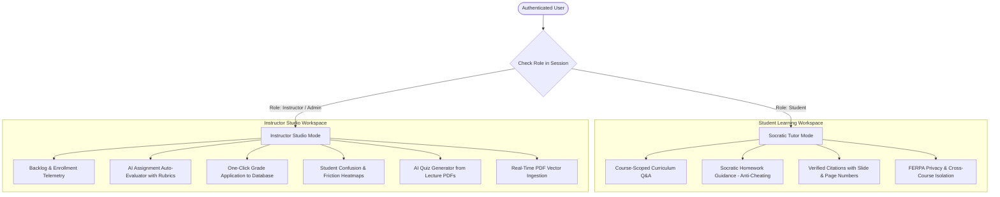

# EduPulse AI Teaching Assistant & Instructor Studio Copilot
## Comprehensive Feature Specification & UI/UX Design System Guide

> **Target Audience:** UI/UX Designers, Frontend Engineers, Product Managers & Design AI Assistants (Gemini / Copilot / Figma).  
> **System Architecture:** Dual-Stack ASP.NET MVC 5 (.NET 4.7.2) + Python FastAPI Microservice (Port 8000) + ChromaDB + Microsoft SQL Server.  
> **Document Purpose:** Complete functional breakdown of all chatbot capabilities, role-based workflows, interactive components, message card patterns, and edge-case states required to design a world-class, bespoke SaaS learning assistant interface.

---

## 1. Executive Summary & Design Vision

The **EduPulse AI Assistant** is not a generic conversational bot or marketing chatbot. It is a **context-aware, curriculum-grounded academic workspace copilot** that seamlessly morphs its persona, capabilities, and UI based on who is logged in and where they are located in the application:

1. **For Students:** Functions as a **Socratic Academic Tutor**. It never gives out direct assignment answers or quiz options. Instead, it guides learners with step-by-step conceptual hints, minimal abstract code examples, and verified textbook/lecture citations with exact page numbers.
2. **For Instructors & Admins:** Morphs into an **Instructor Studio Operations Copilot**. It queries grading backlogs, executes AI-assisted assignment evaluations against grading rubrics, visualizes student learning friction heatmaps, generates multiple-choice quizzes from uploaded lecture PDFs, and allows one-click gradebook commits.

### Core Design Rules (Removing "AI Clutter")
* **No Generic Neon Gradients:** Avoid cliché purple-to-cyan neon bubbles, floating robot head badges, or sparkling star icons (`bi-stars`).
* **High-Craft SaaS Minimalism:** Inspired by **Linear, Notion, GitHub Copilot, and Coursera Business**. Clean white/slate backgrounds, subtle 1px borders (`#e2e8f0`), sharp typography, and micro-elevation.
* **Telemetry Transparency:** Always show learners and instructors *why* an answer is trustworthy via metadata pills (e.g., `Verified Syllabus Citation`, `Instant Semantic Cache <5ms`, `Socratic Mode`).

---

## 2. Dual-Persona Capabilities & Functional Breakdown



### 2.1 Student Persona Capabilities
* **Curriculum-Grounded Q&A:** Answers are synthesized directly from course lecture notes, PDF slides, and module markdown using hybrid retrieval (Dense Semantic Embeddings + Sparse BM25 Keyword Search with Reciprocal Rank Fusion).
* **Course Scoping:** Automatically scopes queries to the active course (`CURRENT_COURSE_ID`). If browsing globally, it allows querying across all enrolled courses while strictly isolating un-enrolled curriculums.
* **Socratic Anti-Cheating Guardrails:**
  * If a student asks: *"Write the complete solution for Assignment 1"*, the bot refuses to write production assignment code. It instead illustrates the design pattern conceptually with unrelated variable names.
  * If a student asks for quiz letter answers (*"Is Question 2 A, B, C, or D?"*), an interceptor halts the query and explains the concept rather than revealing the answer key.
* **Exact Page-Level Citations:** Every curriculum response includes clickable citation chips referencing the exact source file and page (e.g., `Module_1_MVC_Lifecycle.pdf, Page 4`).
* **FERPA Privacy Protection:** Students cannot query the grades, submissions, or performance of other learners.

### 2.2 Instructor & Admin Persona Capabilities
* **Grading Backlog & Enrollment Telemetry:** Natural language queries like *"How many assignments do I need to grade?"* or *"How many students are enrolled in my courses?"* execute live SQL queries against `LMS.StudentSubmissions` and `LMS.Enrollments` and return structured metric cards.
* **AI Assignment Auto-Evaluator:**
  * When an instructor types: *"Evaluate Rahul Verma's assignment submission"* or *"Evaluate submission #7"*, the assistant fetches the student's actual submitted text/code from SQL Server, retrieves the assignment rubric, and outputs an assessment:
    * **Recommended Marks:** e.g., `92 / 100`
    * **Strengths:** Bullet points highlighting correct implementation
    * **Areas for Improvement:** Edge case handling or code smells
    * **Constructive Feedback:** Tailored message for the student
    * **Direct Action Shortcut:** *"Type 'Submit grade 92 for submission 7' to apply to gradebook."*
* **One-Click Grade Application:** Instructors can confirm the grade directly in chat (*"Submit grade 92 for submission 7"*). The bot validates bounds (0–100), verifies instructor course ownership, updates `LMS.StudentSubmissions` in SQL Server, and marks the task as `Approved`.
* **Student Learning Friction Heatmap:** Instructors can query: *"What concepts are students struggling with in Course 2?"*. The assistant analyzes `LMS.StudentQueryLogs` and returns top friction topics, misconception frequencies, and recommended syllabus adjustments.
* **AI Quiz Generator Integration:** Generates 3–5 question multiple-choice quizzes with distractor options, correct answers, and pedagogical rationales directly from course slides.
* **Real-Time Slide Vectorization:** Triggered automatically upon instructor slide upload via `/api/ingest-study-material`, chunking and indexing materials into ChromaDB with zero downtime.

---

## 3. UI/UX Component Architecture & Anatomy

The chatbot interface is structured as a **Slide-Out Drawer Workspace** anchored to the bottom-right of the screen, preserving the user's primary view of their coursework or studio dashboard.

```
+-------------------------------------------------------------------------+
| Drawer Header: [Emblem] Course AI Assistant  [Role Badge]    [_] [X]    |
| Context Scope: [Course Badge: ASP.NET Architecture v]  [Clear Chat]     |
+-------------------------------------------------------------------------+
| Message Scroll Area:                                                    |
|                                                                         |
|  [User Bubble]                                                          |
|  "What is the difference between GET and POST in HTTP idempotency?"     |
|                                                                         |
|  [Assistant Bubble]                                                     |
|  [⚡ Instant Semantic Cache <5ms] [Socratic Guidance]                   |
|  "In HTTP protocol design, GET is idempotent because repeating the     |
|   request produces identical server state without side effects..."      |
|                                                                         |
|  +-------------------------------------------------------------------+  |
|  | Verified Citations:                                               |  |
|  | [📄 Module_1_MVC_Lifecycle.pdf (p. 2)] [📄 HTTP_RFC_Notes.pdf (p. 4)] |  |
|  +-------------------------------------------------------------------+  |
|                                                                         |
|  [Instructor Card - Only in Instructor Mode]                            |
|  +-------------------------------------------------------------------+  |
|  | 🎓 Evaluation: Rahul Verma - Assignment 1                         |  |
|  | Recommended Score: 92/100  [Approved Grade]                       |  |
|  | • Key Strengths: Modular controller separation, async filters     |  |
|  | • Missing: Edge-case null check on user repository payload        |  |
|  | [ Button: Commit 92 Marks to Gradebook ]                          |  |
|  +-------------------------------------------------------------------+  |
+-------------------------------------------------------------------------+
| Starter Suggestion Chips (Dynamic by Role):                             |
| [ 💡 Explain Active Lesson ] [ 📝 Assignment Guidance ] [ ❓ Quiz Hint ] |
+-------------------------------------------------------------------------+
| Input Area:                                                             |
| [ Type a question about your curriculum or assignment...       ] [Send] |
| Footer: [🔒 Academic Grounding Active]    [Gemini 3.5 Flash + ChromaDB]  |
+-------------------------------------------------------------------------+
```

### 3.1 UI Elements Breakdown

#### 1. Floating Launcher Trigger Button
* **Placement:** Fixed at `bottom: 1.5rem; right: 1.5rem; z-index: 1050`.
* **Styling:** Pill-shaped, slate-dark background (`#0f172a`), crisp architectural icon, white text.
* **Status Dot:** Subtle green indicator (`#10b981`) showing real-time FastAPI microservice connectivity.
* **Dynamic Role Pill:**
  * For Students: `Ask Course AI`
  * For Instructors: `Instructor Copilot`
* **Keyboard Shortcut Badge:** Small `Ctrl + /` or `⌘ /` tooltip indicator.

#### 2. Slide-Out Drawer Shell
* **Dimensions:** Width `440px` (or `100vw` on mobile screens $< 768\text{px}$). Height `100vh`.
* **Animation:** Smooth slide from right (`transform: translateX(0)`) using `cubic-bezier(0.16, 1, 0.3, 1)` over 300ms.
* **Backdrop:** Translucent backdrop filter (`rgba(15, 23, 42, 0.25)`) on mobile devices.

#### 3. Drawer Header & Context Switcher
* **Brand Anchor:** Monogram emblem + "EduPulse Assistant".
* **Role Badge:**
  * Student: `Socratic Tutor` (Soft blue: `#e0f2fe` text `#0369a1`).
  * Instructor: `Instructor Studio Mode` (Soft amber: `#fef3c7` text `#b45309`).
  * Admin: `Admin Global Mode` (Soft purple: `#f3e8ff` text `#7e22ce`).
* **Active Scope Pill:**
  * In active course (e.g. `/Courses/Learn/2`): Shows course title (e.g., `Course Scoped: ASP.NET MVC 5 Architecture`).
  * In generic dashboard: Shows `Global Workspace (All Enrolled Courses)`.
* **Controls:** "Clear History" trash icon and "Close Drawer" (`X`) button.

#### 4. Message Bubble Hierarchy & Micro-Badges
* **User Messages:**
  * Aligned right.
  * Slate-dark background (`#0f172a`), white crisp text, rounded with a small bottom-right notch (`border-radius: 16px 16px 4px 16px`).
* **Assistant Messages:**
  * Aligned left.
  * White card with subtle border (`1px solid #e2e8f0`), soft shadow, rounded (`border-radius: 16px 16px 16px 4px`).
* **Telemetry Micro-Pills (Top of Assistant Message):**
  * `⚡ Instant Semantic Cache (<5ms)`: Appears when query matched cache with $\ge 0.94$ cosine similarity. Green accent.
  * `Gemini 3.5 Flash`: Standard tier-1 model indicator.
  * `Tier-2 Failover`: Appears if primary model was rate-limited and cascaded.
  * `Offline Extractive Fallback`: Appears if external API was down and pure local vector excerpts were synthesized.
* **Markdown Rendering:**
  * Code blocks formatted with syntax highlighting, dark slate theme, and a 1-click **"Copy Code"** button.
  * Inline code wrapped in clean slate pills: `` `ModelState.IsValid` ``.
  * Bulleted lists with clean alignment.

#### 5. Interactive Citation Chips Container
* When RAG retrieves course notes, the assistant displays a **Verified Citations** tray at the bottom of the message:
  * Each citation appears as a clickable pill button: `[📄 Course2_Lesson1_MVC.pdf · Page 3]`.
  * **Hover Interaction:** Highlights the relevance score and document type.
  * **Click Interaction:** Opens the slide reader directly to that page in the classroom workspace.

#### 6. Instructor Structured Output Cards (Specialized UI)
When the bot is in Instructor Mode, certain queries generate bespoke interactive UI cards rather than plain text:

* **Assignment Evaluation Dossier Card:**
  * Header: Student Name (`Rahul Verma`), Course Title, Submission Date.
  * Metric Pill: Recommended Score (`92 / 100`) with color-coded ring (Green $\ge 80$, Amber $60-79$, Red $< 60$).
  * Two-column breakdown: **Key Strengths** (green checkmarks) vs. **Missing Benchmarks** (warning icons).
  * Direct CTA button: `[ ⚡ Commit 92 Marks to SQL Gradebook ]` which populates and runs the confirmation command.
* **Student Learning Friction Card:**
  * Visual list of top 3 confusion topics with frequency bars (e.g., *ActionFilter Execution Timing* - 14 student queries).
  * Recommended Action Box: Suggests adding a 5-minute code demo to Module 3.
* **AI Quiz Question Preview Card:**
  * Displays the drafted question, 4 radio-style options, correct answer indicator, and a button: `[ Export to Course Quiz Pool ]`.

#### 7. Quick Starter Prompt Chips (Zero-State)
Empty chat shows personalized prompt pills to reduce blank-slate cognitive load:
* **For Students:**
  * `Explain active lesson concepts`
  * `Give me a hint for the assignment`
  * `Clarify submission deadlines`
* **For Instructors:**
  * `How many assignments are pending evaluation?`
  * `Evaluate latest student submission`
  * `Show student friction heatmap for my course`
  * `Draft a 3-question quiz on this topic`

#### 8. Input Area & Action Bar
* **Textarea/Input:** Auto-resizing single-line to multi-line input with placeholder adapting to role.
* **Send Button:** Round button with upward arrow (`#0f172a`), disabled when input is empty or query is in-flight.
* **Rate-Limit Countdown Banner:** If the user triggers the 5-requests/30-second rate limiter (HTTP 429), the input field disables and displays a live 10-second countdown cooldown timer.
* **Footer Legend:** `🔒 Socratic Anti-Cheating Active · Grounded in Enrolled Notes`.

---

## 4. Complete Edge-Case UI States & Behavior Matrix

The table below describes every system edge case and dictates how the UI must present it:

| Scenario / Edge Case | Trigger / Condition | UI Presentation & Visual State |
| :--- | :--- | :--- |
| **Uncovered Topic / Off-Topic** | Question similarity $< 0.38$ against course notes. | **Grounded Refusal Card:** Soft grey card with compass icon. Message: *"This topic is not covered in your enrolled course curriculum. Consult your syllabus or course discussion board."* No hallucinated content. |
| **Direct Homework Code Solicitation** | Student asks for complete assignment solution. | **Socratic Guidance Banner:** Amber light bulb banner. Displays high-level architectural diagram or abstract pseudocode with dummy variables (`Foo`, `Bar`). Clear notice: *"Socratic Academic Integrity: I cannot provide the final assignment code, but here is how the architectural pattern works."* |
| **Quiz Answer Letter Cheating** | Student asks: *"Is Question 3 A or B?"* | **Integrity Guardrail Banner:** Soft orange shield alert. Message: *"Quiz answers cannot be revealed directly. Paste the concept from the question and we can analyze the theoretical principle together!"* |
| **Prompt Injection / Jailbreak Attack** | Attacker inputs Developer Mode or Base64 exploit. | **Security Alert Callout:** Crisp crimson micro-border card. Message: *"Security Guardrail Triggered: System prompt override attempt intercepted. Assistant operates strictly under educational safety guidelines."* |
| **FERPA Student Grade Snooping** | Student queries another learner's marks. | **Privacy Lock Icon:** Red padlock badge. Message: *"Privacy Policy (FERPA): You may only access your own academic records on your Student Dashboard."* |
| **Burst Spamming / Rate Limit** | User sends $> 5$ requests within 30 seconds. | **Cooldown Overlay:** Input disabled. Amber badge: *"Too many requests. Please wait 12s before sending your next question."* Live countdown updates every second. |
| **Rapid Double-Click (<2s)** | User clicks send twice rapidly. | **Silent Cache Deduplication:** Instantly serves cached response in $< 4\text{ms}$ with `⚡ Instant Semantic Cache` badge. No double-spinner or duplicate bubbles. |
| **Simulated API Outage** | Cloud Gemini API quota exhausted or timeout. | **Tier-3 Offline Extractive Badge:** Grey pill indicator. Raw text excerpts from vector search are synthesized offline with direct citations. Uptime is 100%. |
| **Un-Enrolled Course Access** | Student accesses AI for a course they haven't bought. | **Enrollment Gate Card:** Lock icon with CTA button: *"You are not currently enrolled in this course. [ Explore Curriculum & Enroll ] to unlock the AI Teaching Assistant."* |
| **Invalid Instructor Marks (>100 or <0)** | Instructor inputs *"Submit grade 150"*. | **Validation Error Bubble:** Inline red notice: *"Invalid Marks: Score must be between 0 and 100. (Received: 150). No database changes were saved."* |
| **Cross-Instructor Tampering** | Instructor A tries to grade Instructor B's student. | **Access Denied Card:** Shield with cross: *"Unauthorized: This assignment belongs to Course #2. Only the assigned instructor or Admin may record grades."* |

---

## 5. Technical Data Contracts & API Payload Reference

When developing frontend components or mockups, rely on the exact JSON structures returned by the backend:

### 5.1 Chat Request Payload (`POST /Chatbot/Ask` -> `POST http://127.0.0.1:8000/api/chat`)
```json
{
  "query": "What is the difference between GET and POST in HTTP idempotency?",
  "course_id": 2,
  "enrolled_course_ids": [1, 2, 6],
  "user_id": "2",
  "user_role": "student",
  "top_k": 3
}
```

### 5.2 Chat Response Payload (Success with Citations)
```json
{
  "success": true,
  "data": {
    "query": "What is the difference between GET and POST in HTTP idempotency?",
    "answer": "In HTTP protocol standards, **GET** is classified as an **idempotent** method...\n\n### Key Differences:\n* **GET:** Safe and repeatable without side effects.\n* **POST:** Non-idempotent; creates new resources on each call.",
    "role": "student",
    "course_id": 2,
    "cached": false,
    "model_used": "models/gemini-3.5-flash-lite",
    "sources_count": 2,
    "citations": [
      {
        "source_file": "Course2_Lesson1_ASPNET_Enterprise_Architecture.pdf",
        "page_number": 2
      },
      {
        "source_file": "HTTP_RFC_Standards_Guide.pdf",
        "page_number": 5
      }
    ]
  }
}
```

### 5.3 Instant Semantic Cache Response (`cached: true`)
```json
{
  "success": true,
  "data": {
    "query": "Why is HTTP GET considered idempotent?",
    "answer": "In HTTP protocol standards, **GET** is classified as an **idempotent** method...",
    "role": "student",
    "course_id": 2,
    "cached": true,
    "cache_similarity": 0.962,
    "model_used": "semantic-cache-hit",
    "citations": [
      {
        "source_file": "Course2_Lesson1_ASPNET_Enterprise_Architecture.pdf",
        "page_number": 2
      }
    ]
  }
}
```

### 5.4 Rate Limit HTTP 429 Error Response
```json
{
  "success": false,
  "message": "Rate limit exceeded: You may send up to 5 queries per 30 seconds. Please wait 14 seconds before asking another question."
}
```

---

## 6. Recommended Design Tokens & CSS Specification

For consistent implementation across Razor views and stylesheets:

```css
:root {
    /* Chatbot Primary Palette (Refined Slate & Indigo) */
    --ep-chat-primary: #0f172a;        /* Brand Slate Dark */
    --ep-chat-primary-hover: #1e293b;
    --ep-chat-accent: #2563eb;         /* Action Blue */
    --ep-chat-accent-subtle: #eff6ff;
    
    /* Backgrounds & Elevation */
    --ep-chat-drawer-bg: #ffffff;
    --ep-chat-body-bg: #f8fafc;
    --ep-chat-border: #e2e8f0;
    --ep-chat-drawer-shadow: -10px 0 35px rgba(15, 23, 42, 0.08);
    
    /* Persona Badges */
    --ep-badge-student-bg: #e0f2fe;
    --ep-badge-student-text: #0369a1;
    --ep-badge-instructor-bg: #fef3c7;
    --ep-badge-instructor-text: #b45309;
    
    /* Telemetry & Cache Badges */
    --ep-badge-cache-bg: #dcfce7;
    --ep-badge-cache-text: #15803d;
    --ep-badge-guardrail-bg: #fee2e2;
    --ep-badge-guardrail-text: #b91c1c;

    /* Sizing & Geometry */
    --ep-drawer-width: 440px;
    --ep-bubble-radius-user: 16px 16px 4px 16px;
    --ep-bubble-radius-bot: 16px 16px 16px 4px;
    --ep-chip-radius: 8px;
}
```

---

## 7. Next Steps for UI Redesign

When you are ready to dictate the new visual look for the Chatbot:
1. **Chat Launcher Redesign:** Transitioning from the old floating gradient pill to a bespoke, architectural launcher that matches the new Navbar.
2. **Drawer Redesign (`_ChatWidget.cshtml`):** Replacing old Bootstrap pastel cards with Notion/Linear-grade message bubbles, structured evaluation cards, and citation chip trays.
3. **Classroom Split-Pane Integration (`Learn.cshtml`):** Enabling the chatbot to dock side-by-side with the active video player and lecture PDF slides for seamless note-taking and concept exploration.
