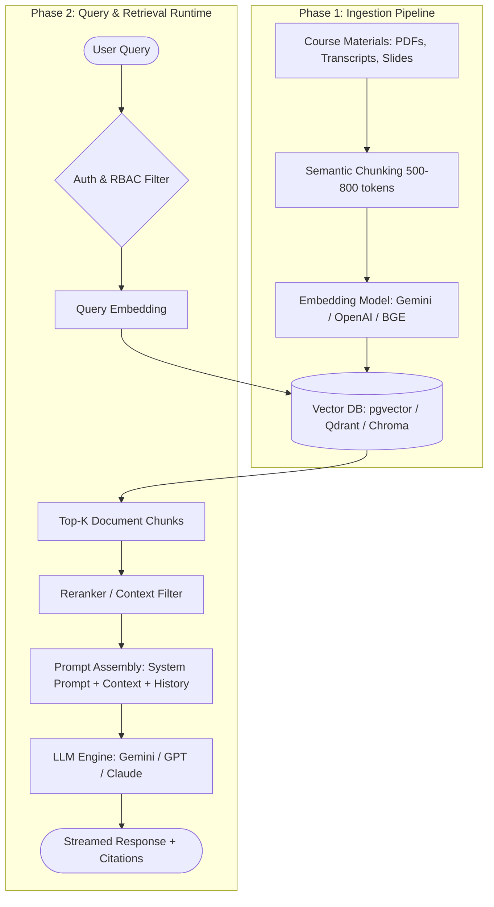

# RAG Chatbot for LMS: Architecture, Specification & Implementation Plan

> **Project Target:** Learning Management System (LMS) Multi-Role AI Assistant  
> **Document Purpose:** Complete technical blueprint and operational specification for developers and AI agents continuing this project.

---

## 1. Executive Summary & Core Motive

### What is this project?
This project aims to build an **intelligent, context-aware, role-based AI assistant** integrated directly into the Learning Management System (LMS). 

Instead of relying on a generic LLM (which hallucinates or gives generic, non-course answers), this system uses **Retrieval-Augmented Generation (RAG)**. The chatbot indexes actual course materials—lecture notes, syllabus files, slide decks, assignment briefs, video transcripts, grading criteria, and institutional policies—and uses that ground-truth context to formulate precise, verified answers with clickable citations.

### Why RAG for an LMS?
1. **Zero Hallucination on Course Facts:** Grounds every response in actual lecture slides, textbook excerpts, or assignment briefs.
2. **Pedagogical Alignment:** Teaches learners conceptually (Socratic hints) instead of giving away direct answers to homework or exams.
3. **Productivity Multiplier for Teachers:** Frees instructors from answering repetitive questions and automates assessment/rubric drafting.
4. **Institutional Governance for Admins:** Ensures data isolation, role-based access control (RBAC), and monitors student learning gaps.

---

## 2. Integration Target & Ecosystem

The chatbot integrates into the LMS across the following surface areas:

- **Frontend Interface:** 
  - A persistent, floating slide-out drawer or docked chat widget on course pages.
  - In-line contextual helpers (e.g., "Ask AI about this lecture" button beside video players or PDFs).
- **Backend & Database:**
  - Connected to the LMS database (users, courses, enrollments, roles).
  - Connected to course storage (S3/local object storage containing PDFs, PPTXs, docs, and video transcripts).
- **Event Hooks:**
  - Triggering re-indexing pipelines when an instructor uploads new course documents or updates an assignment.

---

## 3. Services Served by Role

```
                     ┌────────────────────────────────┐
                     │     Unified RAG Core Engine    │
                     └───────────────┬────────────────┘
                                     │
         ┌───────────────────────────┼───────────────────────────┐
         ▼                           ▼                           ▼
  [ Learner / Student ]     [ Instructor / Teacher ]       [ Administrator ]
  • Socratic Tutoring        • Auto-Quiz & Rubrics       • System & Content Auditing
  • Assignment Guidance      • Student FAQ Analytics     • RBAC & Data Privacy
  • Syllabus & Deadlines     • Drafting Forum Replies    • Vector Index Lifecycle
  • Lecture Search/Citations • Curriculum Gap Analysis   • Quota & Cost Management
```

### 3.1. For the Learner (Student)
- **Socratic Concept Clarifier:** Breaks down complex lecture concepts step-by-step using analogies grounded in the instructor's slides.
- **Assignment Helper (Non-Cheating):** Provides hints, prerequisite reviews, and rubric breakdowns without outputting direct code or final assignment solutions.
- **Course Navigation & Deadlines:** Instant answers to logistical queries (*"When is Assignment 3 due?", "What topics are covered on Midterm 1?"*).
- **Source Verification:** Every answer displays clickable citations back to the source page, slide number, or video timestamp.
- **Multi-lingual Support:** Translates difficult technical terms or explanations into the student's preferred language while preserving domain accuracy.

### 3.2. For the Instructor (Teacher / TA)
- **Automated Assessment Generation:** Generates sample quiz questions (MCQs, short answer, coding problems) with answer keys based directly on selected lectures.
- **Rubric & Prompt Drafting:** Helps draft consistent grading rubrics and assignment instructions.
- **Student Friction Analytics:** Summarizes what concepts students ask the chatbot about most frequently, identifying topics that need revision during live classes.
- **Discussion Forum Reply Assistant:** Drafts suggested responses to common forum queries for the instructor to review and approve with one click.
- **Course Content Audit:** Identifies obsolete or conflicting information across past semesters' materials.

### 3.3. For the Administrator
- **Role-Based Access Control (RBAC):** Enforces strict boundaries—learners can **never** retrieve instructor-only files (drafts, solution manuals, exam answer keys).
- **Indexing & Pipeline Governance:** Dashboard to trigger, monitor, or purge vector indexes per course, semester, or institution.
- **Usage & Cost Analytics:** Tracks token usage, API latency, active user metrics, and query patterns per course/department.
- **Audit Logging & Safety Guardrails:** Logs flagged interactions, academic dishonesty attempts, or toxic queries for administrative review.

---

## 4. Technical Architecture

### 4.1. End-to-End Workflow



### 4.2. Recommended Technology Stack

| Layer | Recommended Options | Why Selected |
| :--- | :--- | :--- |
| **LLM Provider** | Google Gemini 1.5 Flash / Pro, or OpenAI GPT-4o-mini | High context window (up to 1M+ tokens for Gemini), cost-effective, fast streaming. |
| **Embedding Model** | `text-embedding-004` (Gemini) or `text-embedding-3-small` (OpenAI) | Low latency, 1536/768 dimensional embeddings, high semantic accuracy. |
| **Vector Database** | **PostgreSQL + `pgvector`** (Production) or **ChromaDB** (Local Prototype) | If the LMS uses Postgres, `pgvector` eliminates extra infrastructure and keeps user/role relational data in one place. |
| **Orchestration Framework** | **LangChain** (Python/JS) or **LlamaIndex** | Native support for document parsing, chunking, filtering, and retrieval workflows. |
| **Backend API** | FastAPI (Python) or Express / NestJS (Node.js/TypeScript) | Async endpoints, WebSocket/SSE streaming support for chat responses. |
| **Frontend UI** | React / Next.js / Tailwind CSS | Headless UI chat widget, markdown renderer, KaTeX math support, code block highlighting. |

---

## 5. Security, RBAC & Privacy Safeguards

1. **Metadata Isolation:**
   Every chunk in the vector database **must** contain isolation metadata:
   ```json
   {
     "course_id": "CS_201_FALL_2026",
     "module_id": "module_04",
     "visibility": "student", // "student", "instructor_only", "admin"
     "doc_type": "lecture_slide", // "syllabus", "solution_key", "policy"
     "source_file": "lecture_4_trees.pdf",
     "page_number": 14
   }
   ```
2. **Hard-Filtered Retrieval:**
   When a user query arrives, the vector store retrieval query **must enforce hard filtering**:
   - **For Learners:** `filter: { course_id: current_course, visibility: "student" }`
   - **For Instructors:** `filter: { course_id: current_course }`
   Under no circumstance should an LLM prompt receive chunks flagged as `instructor_only` for a student query.

3. **Academic Integrity Prompt Guardrails:**
   The learner system prompt forbids outputting complete homework code or direct assignment answers. It enforces a Socratic pedagogy:
   - Provide hints.
   - Point out error types.
   - Explain underlying theoretical concepts with an illustrative minimal example.

---

## 6. Prompt Engineering Strategy

### 6.1. Learner System Prompt Template
```markdown
You are the dedicated AI Teaching Assistant for [COURSE_NAME].
Your objective is to help learners understand course concepts based strictly on the provided materials.

Guidelines:
1. Base your answer strictly on the provided Context excerpts.
2. If the context does not contain the answer, reply: "I cannot find this information in the course materials. Please consult your instructor or course forum."
3. If the student asks for direct solutions to an assignment, quiz, or homework problem, DO NOT provide the full solution or code. Instead, explain the underlying concept, provide a conceptual hint, and point them to the relevant lecture slide.
4. Always cite your source (e.g., "[Lecture 3, Slide 12]" or "[Syllabus, Section 2]").
5. Keep explanations clear, structured, and encouraging.
```

### 6.2. Instructor System Prompt Template
```markdown
You are an advanced Instructional Design Assistant for [COURSE_NAME].
You have full access to syllabus documents, lecture notes, assignment guidelines, and official solution keys.

Guidelines:
1. Assist the instructor in drafting assessments, rubric items, discussion prompts, and lecture summaries.
2. When asked to draft quiz questions, format them with questions, plausible distractors, correct answers, and pedagogical rationales citing course materials.
3. Highlight any areas where course materials appear inconsistent or where prerequisites are ambiguous.
```

---

## 7. Step-by-Step Implementation Roadmap

### Phase 1: Ingestion & Document Pipeline (Day 1 - 2)
- [ ] Set up document parser for PDFs, Markdown, and TXT files using `pypdf`, `pdfplumber`, or `unstructured`.
- [ ] Implement text chunking (500–800 token chunk size, 100 token overlap).
- [ ] Generate metadata tags for each chunk (`course_id`, `visibility`, `source_file`, `page`).
- [ ] Connect embedding model and verify chunk vector generation.

### Phase 2: Vector Database Setup (Day 2 - 3)
- [ ] Spin up PostgreSQL with `pgvector` (or ChromaDB for local rapid testing).
- [ ] Define vector collection schema and index (HNSW or IVFFlat for cosine distance).
- [ ] Write ingestion script that stores chunks + embeddings + metadata.
- [ ] Write a test script verifying that metadata filtering correctly segregates `student` vs `instructor_only` content.

### Phase 3: RAG Retrieval & Prompt Assembly (Day 3 - 4)
- [ ] Build retrieval function fetching top 3–5 chunks based on query similarity + metadata filter.
- [ ] Implement query context builder formatting excerpts with source references.
- [ ] Integrate LLM client (Gemini / OpenAI) with system prompt templates for student and instructor personas.
- [ ] Test sample student questions and verify citation output.

### Phase 4: API & Backend Integration (Day 4 - 5)
- [ ] Build REST / Server-Sent Events (SSE) streaming endpoints in FastAPI or Express:
  - `POST /api/chat/stream`: Handles query, course ID, session token, streams markdown response.
  - `POST /api/documents/ingest`: Admin/Instructor endpoint to upload and index new documents.
  - `GET /api/analytics/queries`: Admin/Instructor dashboard showing frequent topics and queries.
- [ ] Validate user authentication and role verification before passing queries to the RAG engine.

### Phase 5: LMS Frontend Integration (Day 5 - 6)
- [ ] Embed floating chat component into LMS course pages.
- [ ] Render markdown, LaTeX math formulas (via KaTeX), and code blocks with syntax highlighting.
- [ ] Add clickable citation pills that open the exact source document/page.
- [ ] Add "Clear History" and "Copy Response" buttons.

### Phase 6: Testing, Evaluation & Launch (Day 7)
- [ ] Run benchmark evaluation (e.g., RAGAS or TruLens) testing retrieval precision, groundedness, and answer relevance.
- [ ] Conduct red-teaming: Test if a student can prompt-inject the bot to reveal assignment solutions or instructor keys.
- [ ] Deploy to staging environment for instructor feedback.

---

## 8. Summary for the Incoming Developer / AI Agent

When opening this project in your office or next development session:
1. **Start at Phase 1 & 2:** Create the document ingestion script and initialize your vector store (`pgvector` or `chromadb`).
2. **Review Section 5 (RBAC):** Ensure any schema you build enforces `visibility` and `course_id` filters right from day one.
3. **Use Section 6 for Prompts:** Plug the system prompts directly into your LLM orchestration module.
